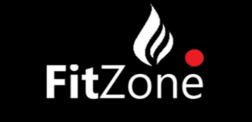
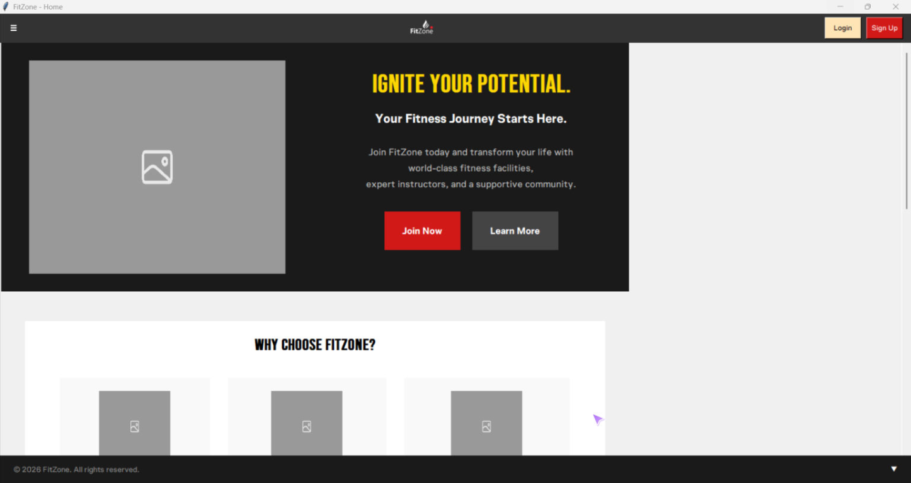

# FitZone

**FitZone** is a desktop gym-management application built with Python, Tkinter, and SQLite. It provides members and gym staff with a complete workflow for registration, membership management, class bookings, BMI analysis, personalised meal plans, and fitness tracking.

<p align="center">
  
</p>

## Preview

<p align="center">
  
</p>

The application opens as a polished 1200 × 800 desktop interface with a responsive navigation menu, gym-selection flow, member dashboard, and dedicated pages for the core features.

Key screens include:

- Gym and membership selection
- Secure login and password recovery
- Member profile management
- Fitness dashboard and BMI tracking
- Meal and workout recommendations
- Class scheduling and booking
- Gym reviews and team profiles

## Features

### Member experience

- Create and manage a member account
- Choose a gym location, membership duration, and package
- Upload a profile image
- Log in securely and reset a forgotten password
- View and update personal profile information

### Gym services

- Browse gym features and team members
- Search, book, and reserve fitness classes
- Detect class scheduling clashes
- View upcoming class schedules and reservations
- Submit and read gym reviews

### Health and planning

- Calculate BMI using metric or imperial units
- View BMI history and visual reports
- Generate personalised meal suggestions
- Generate personalised workout suggestions
- Create meal and workout plans

### Data and reporting

- Store application data in SQLite
- Automatically create the database and sample records at startup
- Generate charts with Matplotlib and SciPy
- Export/import support data through CSV files

## Technology

| Area | Technology |
| --- | --- |
| Interface | Python, Tkinter, Tkinter Ttk |
| Database | SQLite |
| Security | bcrypt |
| Data processing | Pandas, NumPy |
| Visualisation | Matplotlib, SciPy |
| Images | Pillow |
| Date controls | TkCalendar |
| Captcha | Captcha |

## Project structure

```text
FitZone-main/
├── README.md
├── requirements.txt
├── .gitignore
└── FitZone/
    ├── gym_run_page.py          # Application entry point
    ├── gym_*_page.py            # Tkinter page modules
    ├── gym_*_algorithm.py       # Recommendation algorithms
    ├── gym_setup_database.py    # SQLite schema
    ├── gym_setup_sample_data.py # Initial and sample data
    ├── FitZone.db               # SQLite database
    ├── assets/
    │   ├── images/              # Logos and interface images
    │   └── fonts/               # Application fonts
    ├── data/                    # CSV datasets
    └── docs/                    # Project documentation and email templates
```

> Some modules remain top-level in `FitZone/` by design: they use Tkinter callbacks and shared imports that allow the application to start from a single entry point.

## Requirements

- Windows 10 or later
- Python 3.10 or later
- Tkinter (included with standard Windows Python installations)

## Installation

1. Download or clone the repository.
2. Open a terminal in the repository root.
3. Create and activate a virtual environment:

```powershell
python -m venv .venv
.venv\Scripts\Activate.ps1
```

4. Install the dependencies:

```powershell
python -m pip install --upgrade pip
python -m pip install -r requirements.txt
```

## Run the application

From the repository root:

```powershell
python FitZone/gym_run_page.py
```

The application will:

1. Create `FitZone.db` if it does not already exist.
2. Create the required tables.
3. Insert sample locations, packages, classes, meals, and workouts.
4. Open the FitZone home screen.

## Database

SQLite is used for local, persistent storage. The database is initialised by `gym_setup_database.py` and populated with sample data by `gym_setup_sample_data.py`.

Delete `FitZone/FitZone.db` only if you want to reset all accounts and application data. The database will be recreated the next time the application starts.

## Development notes

- Launch the app from the repository root or directly from the `FitZone` directory.
- Keep image, font, CSV, database, and text resources beside or below their configured paths.
- Do not commit virtual environments or generated Python cache folders.
- A password reset email can require valid SMTP credentials in `gym_email_verification.py`.


